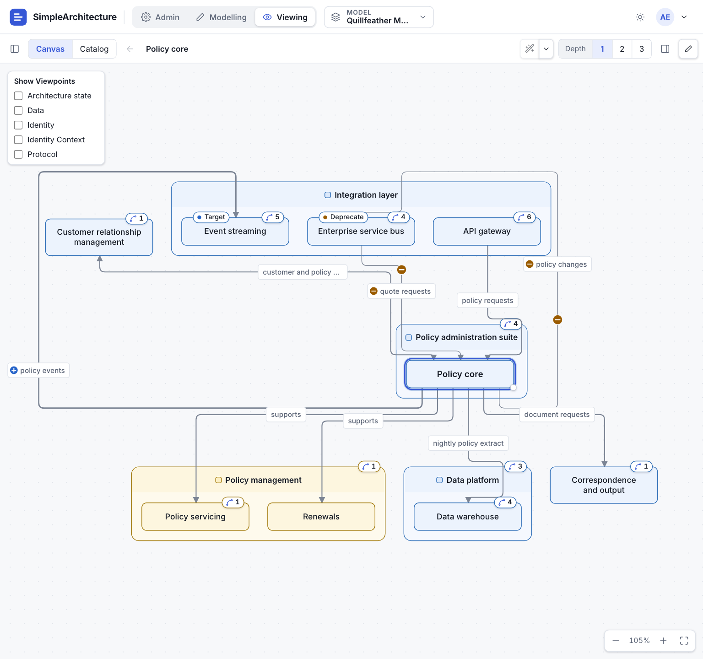
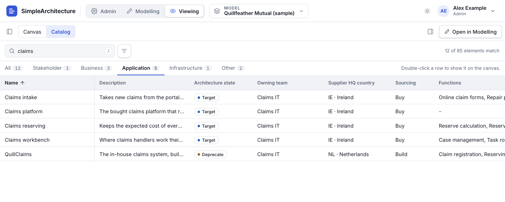
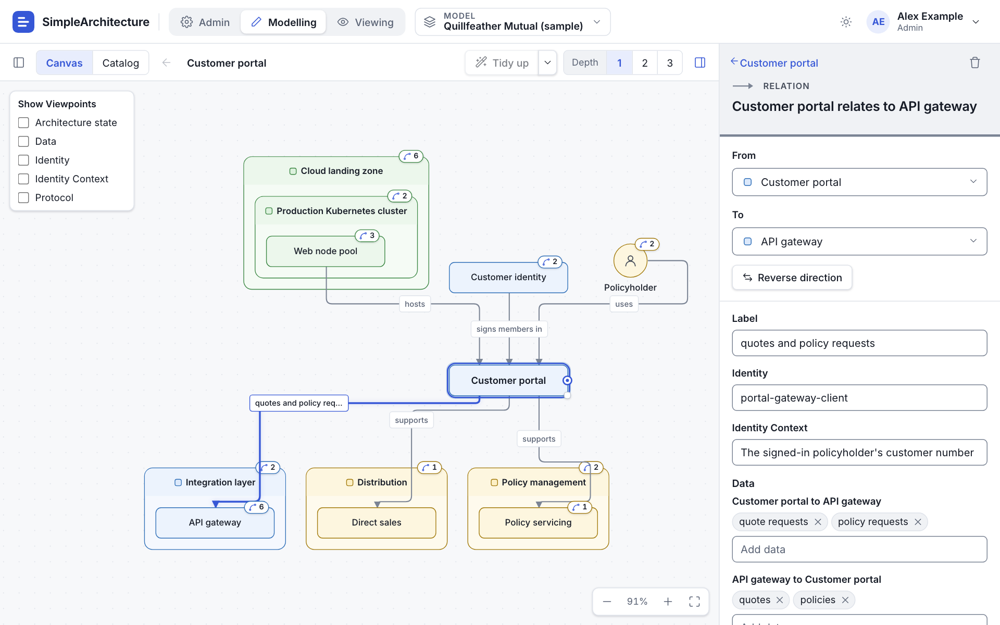

# SimpleArchitecture

SimpleArchitecture is a web app for modelling your IT landscape. You record your stakeholders, business functions, applications and infrastructure as elements, connect them with relationships, and explore the result on a canvas that lays itself out. It uses a small, clear metamodel rather than the full ArchiMate language, and it can import ArchiMate exchange files.

**Beta.** Version 0.60 is the first public release. It does what this page describes, but few people have used it so far. Expect rough edges, back up your database, and please report what you find.

**Made in the Netherlands.** SimpleArchitecture is built in the Netherlands, in Europe. You run it yourself: one container next to your own PostgreSQL database. It connects only to that database and to your own sign-in provider. There is no telemetry, no analytics and no update check, so your models stay with you.

## What you can do

- **Model** your landscape as elements and relationships, against a [small metamodel](metamodel/default-metamodel.md): Stakeholder, Business, Application, Infrastructure and Other, linked by Relation and Contains. Your Admin adds the extra properties elements and relationships need, such as a cost centre, or references from an element to others.
- **Explore** a canvas centred on one element, with what it relates to, laid out for you. Elements that contain others are drawn with them inside, and cards can be grouped by a property, such as Owning team.
- **Save views**, arrange them by hand and group them in folders.
- **Show what matters** on the lines with Show Viewpoints: the identity used, the data that flows each way, the architecture state, or properties your Admin defines.
- **List and find** elements in the catalog, with search, filters and a CSV download.
- **Import** ArchiMate exchange files (OEF) and JSON Graph Format files, and **export** JSON Graph Format.
- **Ask an AI agent:** agents such as Claude can read the models you can see, through the app's MCP endpoint, and for a Modeller add and change elements and relationships.
- **Sign in** with your own OpenID Connect provider, such as Microsoft Entra ID, with three roles: Viewer, Modeller and Admin.

## Screenshots

These show the made-up sample model, an insurer (`samples/`).

The canvas in Viewing: one element in the middle, with what it relates to and the state of each relationship.



The catalog: every element of a type in a table, with search and filters. In Modelling, **Download CSV** saves the table as shown.



Modelling: the same canvas, with the selected relationship's details editable next to it.



## Run it

You need:

- a machine with Docker and Docker Compose;
- an OpenID Connect provider that can send roles or groups in the ID token (no provider is included);
- a domain name, and an https proxy in front of the app, such as Caddy or nginx.

Copy the `deploy/compose/` folder to the server, then:

```sh
cp example.env .env    # fill in every value; keep .env private
docker compose up -d
```

Register `https://<APP_DOMAIN>/auth/callback` as the redirect address with your provider, and point your https proxy at the app's port. Full steps: [Run with Docker Compose](guide/docker-compose.md). Other container hosts: [Hosting the image](guide/hosting.md).

To try it with made-up data, sign in as an Admin and import `samples/sample-insurance.jgf.json` on **Admin → Models**.

Use SimpleArchitecture in a desktop browser, with a mouse and keyboard. Phones and tablets aren't supported.

## Documentation

All pages are listed in [the guide](guide/README.md).

- **Using the app:** in the app, choose **Help** in the account menu (your name, top right). The same subjects, in more detail, are in [the guide](guide/README.md). To let an AI agent read your models, see [Connect an AI agent](guide/connect-an-ai-agent.md).
- **Hosting:** [Run with Docker Compose](guide/docker-compose.md), [Hosting the image](guide/hosting.md), [Sign-in and roles](guide/sign-in.md), [Azure examples](guide/azure.md), [Database](guide/database.md)
- **For IT and security teams:** [Security overview](guide/security-overview.md), including how to verify a release
- **Building from source:** [Development](guide/development.md)
- **Release notes:** [0.76.0](guide/releases/v0.76.0.md), [0.75.0](guide/releases/v0.75.0.md), [0.74.6](guide/releases/v0.74.6.md), [0.74.4](guide/releases/v0.74.4.md), [0.74.3](guide/releases/v0.74.3.md), [0.74.2](guide/releases/v0.74.2.md), [0.74.1](guide/releases/v0.74.1.md), [0.74.0](guide/releases/v0.74.0.md), [0.73.0](guide/releases/v0.73.0.md), [0.72.0](guide/releases/v0.72.0.md), [0.71.0](guide/releases/v0.71.0.md), [0.70.0](guide/releases/v0.70.0.md), [0.69.0](guide/releases/v0.69.0.md), [0.68.0](guide/releases/v0.68.0.md), [0.67.1](guide/releases/v0.67.1.md), [0.67.0](guide/releases/v0.67.0.md), [0.66.0](guide/releases/v0.66.0.md), [0.65.2](guide/releases/v0.65.2.md), [0.65.0](guide/releases/v0.65.0.md), [0.64.0](guide/releases/v0.64.0.md), [0.63.0](guide/releases/v0.63.0.md), [0.60.0 (beta)](guide/releases/v0.60.0.md)

## Licence

SimpleArchitecture is **source-available and free to use. It is not open source.** The [LICENSE](LICENSE) file holds the terms. In short:

- **You may** run and modify it for internal business, personal or non-commercial use, pass it on free of charge with the licence and notices kept and modified copies marked, and use it as a consultant in your work for clients.
- **You may not** sell it, sell hosting of it, offer it as a paid service, or remove its notices.

It comes with no warranty. The app needs no licence file or key, and it never calls anyone about its licence.

## Security

To report a vulnerability, follow [SECURITY.md](SECURITY.md), never a public issue. For IT and security teams, the [security overview](guide/security-overview.md) says what the app stores, what it connects to, how sign-in and roles work, and how to verify a release.

## Report a problem or ask for a change

Want a change? Please create a [GitHub issue](https://github.com/johannsmit/simplearchitecture/issues). Report a security problem privately instead, as [SECURITY.md](SECURITY.md) says. Don't paste real model data or secrets into an issue.

Bug reports and ideas are welcome; code contributions aren't taken.

## Support SimpleArchitecture

SimpleArchitecture is free to use. If it is useful to you, you can support its development with a gift (link to follow). A gift buys no features, support or rights, and the licence stays the same.
