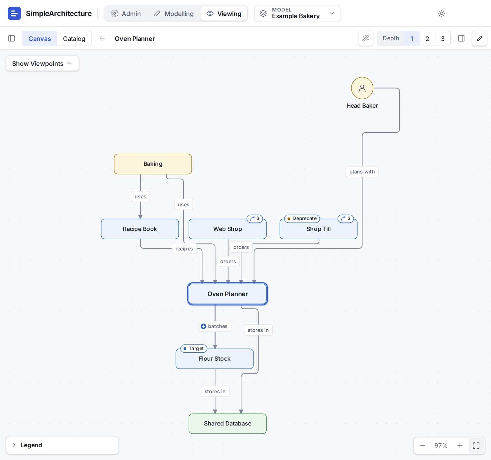
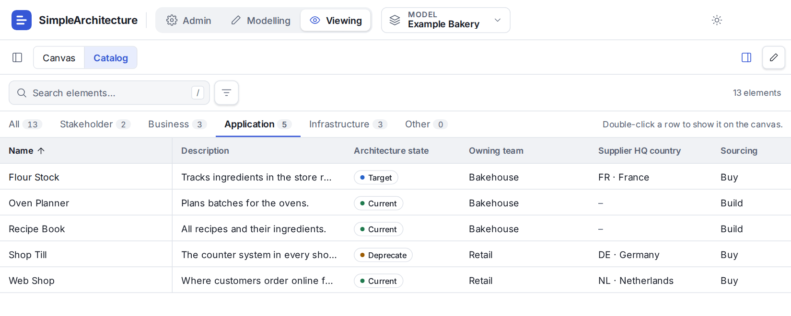
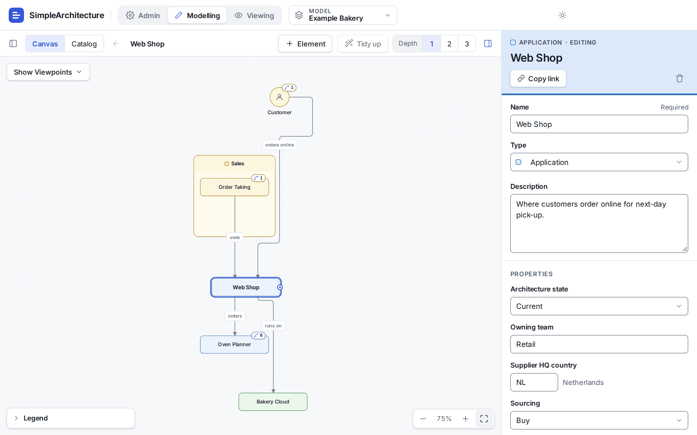

# SimpleArchitecture

An IT architecture modelling application: a React Progressive Web App (`frontend/`) and a Node.js API (`backend/`), with shared TypeScript types (`shared/`). Architects build a relational model of their landscape, elements and relationships, against a simple metamodel (see [metamodel/](metamodel/default-metamodel.md)), and exchange models as JSON Graph Format files.

## Screenshots

These show a made-up bakery.

The canvas in Viewing: one element in the middle, with what it relates to and the state of each relationship.



The catalog: every element of a type in a table, with search and filters. In Modelling, **Download CSV** saves the table as shown.



Modelling: the same canvas, with the selected element's details editable next to it.



## Licence

SimpleArchitecture is **source-available and free to use. It is not open source.** The [LICENSE](LICENSE) file holds the terms. In short:

- **You may** run and modify it for internal business, personal or non-commercial use, pass it on free of charge with the licence and notices kept and modified copies marked, and use it as a consultant in your work for clients.
- **You may not** sell it, sell hosting of it, offer it as a paid service, or remove its notices.

It comes with no warranty. The app needs no licence file or key, and it never calls anyone about its licence.

Bug reports and ideas are welcome as issues; code contributions aren't taken.

## Security

- [SECURITY.md](SECURITY.md): how to report a vulnerability and supported versions.
- [guide/security-overview.md](guide/security-overview.md): for IT and security teams: what is stored and where, what the app connects to, sign-in and roles, the audit trail, the hardening, and what the host is responsible for.

## Prerequisites

- Node.js 26.13 LTS or later
- npm 11 or later (comes with Node.js)

Development needs a PostgreSQL database (see Database). The tests need no database and no Docker.

## Getting started

```sh
npm install
cp .env.example .env   # then fill in the twelve settings (see Configuration)
chmod 600 .env
npm run dev
```

- Web app: http://localhost:5173 (`FRONTEND_PORT`)
- API: http://localhost:3000 (`BACKEND_PORT`; for example http://localhost:3000/api/health)

In development the web app proxies `/api` and `/auth` to the API, so the browser only talks to the web app's port, except for the sign-in callback, which the provider sends to `http://<APP_DOMAIN>:<BACKEND_PORT>/auth/callback`. The header shows whether the API is reachable.

To try the app with made-up data, sign in as an Admin, open Admin → Models and import `samples/sample-insurance.jgf.json`, or `samples/sample-insurance.oef.xml` to try the ArchiMate import: Quillfeather Mutual, an invented insurer.

## Commands

Run these from the repository root.

| Command             | What it does                                                                          |
| ------------------- | ------------------------------------------------------------------------------------- |
| `npm run dev`       | Starts the API (with reload) and the web dev server together                          |
| `npm run build`     | Builds `shared/`, `backend/` (to `backend/dist`) and `frontend/` (to `frontend/dist`) |
| `npm run lint`      | Lints all workspaces with ESLint                                                      |
| `npm run typecheck` | Type-checks all workspaces with TypeScript                                            |
| `npm test`          | Runs all tests once with Vitest (`npm run test:watch` to watch)                       |
| `npm run format`    | Formats all files with Prettier (`npm run format:check` to check)                     |

To try the production build, including the service worker and installing the app:

```sh
npm run build
npm run start -w backend      # the API on BACKEND_PORT
npm run preview -w frontend    # the built web app on FRONTEND_PORT, proxying /api and /auth to the API
```

The service worker is only active in the production build, not in `npm run dev`.

## Configuration

In development the API and the web dev server read exactly twelve settings from `.env` in the repository root, all required: the image's ten (`APP_DOMAIN`, `DATABASE_URL`, `OIDC_ISSUER`, `OIDC_CLIENT_ID`, `OIDC_CLIENT_SECRET`, `SESSION_SECRET`, `OIDC_ROLES_CLAIM`, `OIDC_ROLE_ADMIN`, `OIDC_ROLE_MODELLER`, `OIDC_ROLE_VIEWER`) plus `FRONTEND_PORT` and `BACKEND_PORT` (see `.env.example`). They refuse to start if one is missing or invalid; the API lists the twelve. Everything else is fixed: plain http, the web app at `http://<APP_DOMAIN>:<FRONTEND_PORT>`, the API and the sign-in callback at `http://<APP_DOMAIN>:<BACKEND_PORT>/auth/callback` (register exactly that redirect address at the provider), logs at `info`. Use `APP_DOMAIN=localhost`: providers allow plain http for localhost only. Any other setting in `.env` is ignored, with a warning naming it. An old `ENTRA_…` setting is ignored too, and the warning names its replacement. The optional sign-in settings for Azure Kubernetes Service (`OIDC_CLIENT_AUTH`, `DATABASE_AUTH` and the `AZURE_…` settings, see Hosting the image) are read when set; a standard setup sets none of them.

The hosted image reads the same ten, without the ports (see Hosting the image).

Never commit `.env` or any secrets. Only `.env.example` is tracked.

## Sign-in and access

Sign-in uses OpenID Connect, handled entirely by the API. Microsoft Entra ID is one such provider (see Hosting the image), and others work too (see Using another provider):

1. The web app calls `GET /api/me`. A 401 shows the signed-out page.
2. **Sign in** goes to `/auth/login`, which redirects to the provider (authorization code flow with PKCE, state and nonce).
3. The provider returns to `/auth/callback`. The API validates the ID token, creates a server-side session and redirects to the web app.
4. **Sign out** posts to `/auth/logout`, which ends the session and sends the browser on to the provider's sign-out page, or to the app's home page if the provider has none.

The browser only holds an httpOnly session id cookie. Tokens never reach the browser. Sessions are kept in PostgreSQL (only a hash of the session id is stored), so restarting the API signs nobody out. Sessions end after 30 minutes without a request or 8 hours after sign-in, and expired ones are removed every 10 minutes.

Access comes from one claim in the ID token, named by `OIDC_ROLES_CLAIM`, and roles are cumulative. On Entra ID that claim is `roles`, holding the app roles. The values that give each role are set with `OIDC_ROLE_ADMIN`, `OIDC_ROLE_MODELLER` and `OIDC_ROLE_VIEWER` (all three required), so they can match however an organisation names them. They are matched exactly, case included. A user with no matching value gets no access.

| Role     | Spaces                    |
| -------- | ------------------------- |
| Admin    | Admin, Modelling, Viewing |
| Modeller | Modelling, Viewing        |
| Viewer   | Viewing                   |
| (none)   | none                      |

Every API route declares its access rule. The API refuses to register a route without one.

## Connect an AI agent (MCP)

AI agents such as Claude can read the models a user can see in Viewing, through the MCP endpoint `https://<APP_DOMAIN>/mcp`. The user adds that address in the agent, signs in through the browser with the usual sign-in, and allows the agent on a consent page. Nothing to set up at the provider and no new settings: the app is its own small OAuth server for agents, built from `APP_DOMAIN`, and needs PostgreSQL. The steps for Claude (claude.ai, Desktop and Claude Code) are in [Connect an AI agent](guide/connect-an-ai-agent.md), and the rules in the [security overview](guide/security-overview.md#ai-agents-mcp).

- Endpoints: `/.well-known/oauth-protected-resource` (also with `/mcp` after it) and `/.well-known/oauth-authorization-server`, `POST /oauth/register`, `GET /oauth/authorize`, `POST /oauth/token`, `POST /oauth/revoke` and `POST /mcp` (Streamable HTTP, stateless). The consent page is `/agents/connect`.
- Public clients with PKCE only. Access tokens last 1 hour, refresh tokens change on every use, and a connection ends 7 days after the user allowed it. The tokens work only on `/mcp`, and `/mcp` takes only them.
- Users disconnect their agents under **Connected apps** (account menu, `/agents`); Admins can disconnect anyone's under **Admin** > **Connected apps**.
- claude.ai and Claude Desktop call the app from Anthropic's servers (`160.79.104.0/21`), so the host must let them reach `/.well-known/`, `/oauth/register`, `/oauth/token` and `/mcp`. Claude Code calls it from the user's computer.
- In development, the web app's dev server passes `/oauth`, `/mcp` and `/.well-known/oauth-*` on to the API, so the address is `http://<APP_DOMAIN>:<FRONTEND_PORT>/mcp` (Claude Code accepts plain http on localhost).

## Model storage

Models are stored in PostgreSQL (see Database). Earlier versions, and the tests, store them as JSON Graph Format files, one per model, in a folder (`data/` at the repository root); `db:import-files` copies such files into the database. The rules below are for those files. The API creates the folder at startup if it's missing and keeps it owner-only (folder 700, files 600): it removes group and other permissions, but never adds any, so it refuses to start if it can't write there. It also refuses the file-system root, your home folder itself, the repo root or a folder that contains it. A leading `~/` means your home folder.

- `data/` is git-ignored because it holds real models. Never commit it, and back it up yourself.
- Each file is `<id>.json`, where the id is a UUID chosen by the server. The file is a complete JGF document. The server's own data (id, name, created at and by, node and edge counts, and `sourceId`) is in `graph.id` and `graph.metadata["simplearchitecture:stored"]`, and the server replaces whatever a client sends there. `sourceId` keeps the `graph.id` the client sent, such as the OEF model identifier.
- Saves write a temporary file, rename it and sync the folder, so a model file is never half-written. Saves and deletes run one at a time within the API process, so run only one API process per folder.
- At most 500 models are stored, and a model file is at most 10 MB (twice the JGF upload limit); a larger model isn't saved (413) and a larger file isn't read.
- Only regular files are models. A folder, symlink, FIFO or other entry with a model's name is never opened or followed, isn't listed and doesn't count towards the 500. The API logs its name once.
- A damaged file is left out of the list (the API logs its file name). Admins see it by id on Admin → Models, under "Damaged models", and can delete it there.

| Endpoint                        | Space   | What it does                                                      |
| ------------------------------- | ------- | ----------------------------------------------------------------- |
| `GET /api/models`               | Viewing | Lists the stored models (metadata only), newest first             |
| `GET /api/models/:id`           | Viewing | Returns one model as JGF                                          |
| `GET /api/admin/models/damaged` | Admin   | Lists the ids of damaged model files (never their content)        |
| `POST /api/models`              | Admin   | Validates and saves a JGF model (201; 422 if it has errors)       |
| `POST /api/models/new`          | Admin   | Creates an empty model from `{ "name" }` (201; 422 with `fields`) |
| `POST /api/models/import/oef`   | Admin   | Converts an ArchiMate OEF file, validates and saves it            |
| `DELETE /api/models/:id`        | Admin   | Deletes a model (204), or an odd entry with its name              |

On Admin → Models, an Admin downloads a model as a JGF file with each row's Export button, which uses `GET /api/models/:id`. Treat the file as confidential.

**Import file**, on the same page, takes such a JGF file (`.json`, at most 5 MB, through `POST /api/models`) or an ArchiMate OEF file (`.xml`, at most 10 MB). A file saved by Export comes back as a new model, with a new id and the same elements and relationships. The server validates it as it does any import: a file with errors gets 422 with the list and nothing is saved, and the server's own details (id, who created it, when) are set anew.

The OEF import maps relationship types with `config/oef-mapping.json`. Every imported relationship is one way, except an Association without `isDirected="true"` (ArchiMate's default is undirected): it imports as two-way when its edge type can be (Relation). A Flow imports as a Relation with its name as its Request Data, and a JGF file with the older types `Information flow` or `Integration`, or with the retired `"informationFlow": true`, converts on import, with a note in the report: each becomes a Relation, and a labelled Information flow gets its label as Request Data (unless it has Data already). A JGF file with the older Data (`"data"`) converts on import too, with a note in the report: Data becomes Request Data (`"requestData"`), unless the relationship has Request Data already (then both are kept as they are, with a warning), and every `{Data}` in a label becomes `{Request Data}`.

`GET /api/models` also says `editable`: whether elements can be edited. Editing needs the database; without one, Modelling is read-only and the element routes below answer 501.

### Editing elements (Modelling, PostgreSQL only)

| Endpoint                                               | Space     | What it does                                                         |
| ------------------------------------------------------ | --------- | -------------------------------------------------------------------- |
| `GET /api/models/:id/elements/:elementId`              | Modelling | One element (`node` as JGF) with its `version`, for the editing form |
| `POST /api/models/:id/elements`                        | Modelling | Adds an element with a server-chosen id (201, version 1)             |
| `PATCH /api/models/:id/elements/:elementId`            | Modelling | Changes the fields sent; the body carries the `version` read (200)   |
| `DELETE /api/models/:id/elements/:elementId?version=N` | Modelling | Deletes the element and every relationship from or to it (200)       |

- Bodies are JSON: `type`, `name`, `description` and `metadata` (standard properties and custom metadata, keyed as stored). In a PATCH, only the fields sent change, and `null` removes a description or a metadata value. The shapes are in `shared/src/elements.ts`.
- Each element has a version. An update or delete with an older one gets 409 with `currentVersion`, and nothing is stored. Changes to one model take turns (a row lock), so two people can't overwrite each other.
- Every change is checked against the whole model (the full validation); one that would give it an error gets 422 with `fields` (`name`, `type`, `description`, `metadata.<key>`, or `''` for a general message). Warnings don't stop a change and are returned. 404 says which is `missing`: the `model` or the `element`.
- Changing the type keeps every value: standard properties the new type doesn't have become custom metadata. Deleting a container deletes its Contains relationships; the elements in it stay, no longer nested (`unnestedElementIds`).
- Caps per change: name 200 characters, description 10,000, metadata key 100 and value 2,000 characters, at most 100 metadata entries and 100 list values. Values that aren't changed (for example a longer imported one sent back by the form) aren't checked.
- Every stored change writes one `audit` row in the same transaction: the user's id and name, the time, the action (`element-added`, `element-updated`, `element-deleted`), the model and element ids, and the names of the changed fields (never their values). A refused change writes none.

### Editing relationships (Modelling, PostgreSQL only)

| Endpoint                                                         | Space     | What it does                                                              |
| ---------------------------------------------------------------- | --------- | ------------------------------------------------------------------------- |
| `GET /api/models/:id/relationships/:relationshipId`              | Modelling | One relationship (`edge` as JGF) with its `version`, for the editing form |
| `POST /api/models/:id/relationships`                             | Modelling | Adds a relationship with a server-chosen id, last in the model (201)      |
| `PATCH /api/models/:id/relationships/:relationshipId`            | Modelling | Changes the fields sent, or reverses it; the body carries the `version`   |
| `DELETE /api/models/:id/relationships/:relationshipId?version=N` | Modelling | Deletes the relationship (200); its ends stay                             |

- Bodies are JSON. A POST sends `source` and `target` (element ids), `type` (an edge type), and optionally `architectureState` (default Current) and `description`. A PATCH sends `metadata` (custom properties: text, with `null` removing a key) and any of `type`, `architectureState`, `description` (`null` removes it), `label` (trimmed, stored as JGF `label` as typed, `{Property}` names included; `null` or blank removes it), `reverse: true` (swaps source and target; same id and history), `twoWay` (`true`: both ways, stored as JGF `"directed": false`; `false`: one way) and `identity`, `identityContext`, `requestData` and `responseData` (text, trimmed; `null` or blank removes it). Only a Relation can be two-way or have Identity, Identity Context, Request Data and Response Data: a type change to Contains makes it one way and removes those four, and `twoWay: true` or one of them on Contains is refused. They are never sent in `metadata`, and nor are the retired keys `informationFlow` and `data` (a `data` kept from before can only be removed, with `null`). New relationships are one way. The shapes are in `shared/src/relationships.ts`.
- Only relationships with an id can be edited or be in a view. JGF edge ids are optional, so an import (JGF or OEF) gives every relationship without an id a new one, a UUID as new relationships get; ids in the file are kept. Relationships stored without an id by an earlier version stay read-only.
- The same version, conflict (409), validation and size rules as for elements. 422 `fields` name `source`, `target`, `type`, `architectureState`, `description`, `label`, `version`, `reverse`, `twoWay`, `identity`, `identityContext`, `requestData`, `responseData`, `metadata.<key>` or `''`. 404 says which is `missing`: the `model`, the `relationship`, or the `source` or `target` element of a new one.
- Rules for changes made here (stored models are never checked against them): an element can't be related to itself (any type), and a Contains change can't make a cycle. The same Contains twice is refused with `duplicateOf` (the existing relationship's id); several Relations may link the same two elements. A second container is allowed, with a `multiple-containers` warning; the element stays nested in the first Contains in the model's order, and new relationships are added at the end. The rules are checked again on a type change and on reverse.
- Results list `nestingChanges`: each element now drawn inside another container (`containerId`) or not nested (`null`), so the canvas can update without a reload.
- Caps per change: description 10,000 characters, label 200 characters, element ids 1,000, body 64 KB. An imported label or description that is longer stays until it is changed.
- Every stored change writes one `audit` row in the same transaction, as for elements, with the relationship id and the action `relationship-added`, `relationship-updated`, `relationship-reversed` or `relationship-deleted`.

### Views (PostgreSQL only)

| Endpoint                                         | Space     | What it does                                                                          |
| ------------------------------------------------ | --------- | ------------------------------------------------------------------------------------- |
| `GET /api/models/:id/views`                      | Viewing   | The model's views (name, version, counts), by name                                    |
| `GET /api/models/:id/views/:viewId`              | Viewing   | One view with its element and relationship ids and its `layout`, in the model's order |
| `POST /api/models/:id/views`                     | Modelling | Saves a view from `name`, `elementIds` and `relationshipIds` (201)                    |
| `PATCH /api/models/:id/views/:viewId`            | Modelling | Renames it; the body carries the `version` read                                       |
| `PUT /api/models/:id/views/:viewId/contents`     | Modelling | Replaces its elements and relationships; the body carries the version                 |
| `PUT /api/models/:id/views/:viewId/layout`       | Modelling | Replaces where its cards are (`cards`); the body carries the version                  |
| `DELETE /api/models/:id/views/:viewId?version=N` | Modelling | Deletes the view; its elements and relationships stay in the model                    |

- A view refers to elements and relationships by id and never changes the model. Every id must be in the model, and a relationship may be in a view only with both of its elements. Without `relationshipIds`, new contents keep the view's relationships whose two elements are still in it.
- Names are trimmed, 1 to 200 characters, and unique within the model, ignoring case (422 on `name`). At most 150 elements and 5,000 relationships per view, and 500 views per model.
- A layout is a list of `{ elementId, x, y, width? }`: a card's top left corner on the canvas, in pixels (also for a card drawn inside a container), and a width set by hand, a whole number from 168 to 480. Each card at most once, only cards in the view, and positions from -1,000,000 to 1,000,000 (422 on `cards`). A card not sent has no position afterwards; the same layout as stored changes nothing. Taking a card out of the view, or deleting its element, drops its position. The web app sends a layout only after the person moved, resized, added or removed a card, or chose Tidy up.
- The same version (409 with `currentVersion`), validation (422 with `fields`) and 404 (`missing`: `model` or `view`) rules as for elements. Every stored change writes one `audit` row (`view-added`, `view-renamed`, `view-changed`, `view-deleted`) with field names and counts, never the name or a position (a new layout is `view-changed` with the field `layout`).
- Deleting an element or a relationship removes it from every view, and deleting a model deletes its views. Views aren't part of the JGF export or import.

### Branding (Admin, PostgreSQL only)

Branding needs the database. Without one, everyone sees the neutral look, `GET /api/branding` answers it with `version: 0`, and the Admin routes answer 501.

| Endpoint                                    | Access | What it does                                                                   |
| ------------------------------------------- | ------ | ------------------------------------------------------------------------------ |
| `GET /api/branding`                         | Public | `{ primary, secondary, logoUrl, version }`: colours as `#rrggbb` or `null`     |
| `GET /api/branding/logo?v=N`                | Public | The logo's bytes with their stored type; 404 when there is none                |
| `PUT /api/admin/branding`                   | Admin  | Sets both colours: JSON `{ primary, secondary, version }` (`null` removes one) |
| `PUT /api/admin/branding/logo?version=N`    | Admin  | Sets the logo: the raw file as `image/png`, `image/jpeg` or `image/webp`       |
| `DELETE /api/admin/branding/logo?version=N` | Admin  | Removes the logo                                                               |
| `DELETE /api/admin/branding?version=N`      | Admin  | Resets to the neutral look: no colours and no logo                             |

- The public routes need no sign-in, because the signed-out page is branded too. They return the colours and the logo only: no ids and no names.
- Every Admin change answers with the new branding (the same shape as `GET /api/branding`). Each change carries the version read; an older one gets 409 with `currentVersion`, and nothing is stored. A change that changes nothing keeps the version.
- Colours must be `#` and six hexadecimal digits; they are stored in lower case. Anything else gets 422 with `fields` (`primary`, `secondary`, `version` or `''`).
- A logo must be a PNG, JPEG or WebP file, at most 300 KB and 1024 × 1024 pixels. The file's own first bytes decide its type (never its name); the size is read from the image header, without decoding the image. Another declared type or content (an SVG, HTML, a GIF) gets 415, a larger file 413, and a damaged file or one with more pixels 422 with field `logo`. SVG isn't accepted, because it can carry scripts.
- The logo is served with its stored type, `X-Content-Type-Options: nosniff`, `Content-Disposition: inline` and a Content-Security-Policy that lets nothing run. `logoUrl` carries the version, so that URL is cached for a year; any other URL isn't cached.
- Every stored change writes one `audit` row (no model id): the user's id and name, the action (`branding-colours-changed`, `branding-logo-set`, `branding-logo-removed`, `branding-reset`) and the changed field names (`primary`, `secondary`, `logo`), never the colours or the image. Migration `004_branding.sql` adds the one-row `branding` table.

## Database

The API stores models and sessions in PostgreSQL, set with `DATABASE_URL` (required in development and in the image).

### 1. Create the role and the database (once, on the server)

Run this as an admin on the PostgreSQL server, for example in `psql`. Use a strong, random password: `openssl rand -hex 32` gives one that needs no escaping in a URL. Type it only into `psql` and your `.env`, never into chat, tickets or commits.

```sql
-- The application's own role: it can sign in, but it isn't a superuser and can't create
-- databases or roles.
CREATE ROLE simplearchitecture WITH LOGIN PASSWORD 'paste-the-generated-password-here'
  NOSUPERUSER NOCREATEDB NOCREATEROLE NOREPLICATION NOBYPASSRLS;

-- The database, owned by that role.
CREATE DATABASE simplearchitecture OWNER simplearchitecture ENCODING 'UTF8';

-- Connect to the new database (in psql: \c simplearchitecture), then:
REVOKE CREATE ON SCHEMA public FROM PUBLIC;
REVOKE ALL ON DATABASE simplearchitecture FROM PUBLIC;
GRANT CONNECT ON DATABASE simplearchitecture TO simplearchitecture;
-- PostgreSQL 14 or older only (15 and later already give the database owner the public schema):
ALTER SCHEMA public OWNER TO simplearchitecture;
```

The role owns only its own database. The API creates and updates its tables there itself, with the migrations in `backend/migrations/`, so it needs no other rights.

### 2. Allow your machine through the server's firewall

If the server (or its cloud provider, such as Azure Database for PostgreSQL) has a firewall, allow your machine's public IP address on the PostgreSQL port (usually 5432). Remove the rule when you no longer need it.

### 3. Set `DATABASE_URL` in `.env`

```sh
DATABASE_URL=postgres://simplearchitecture:<password>@db.example.com:5432/simplearchitecture?sslmode=verify-full
```

- For any host other than `localhost` or `127.0.0.1`, the API always uses TLS and verifies the server's certificate and host name. It refuses to start if `sslmode` asks for less (`disable`, `allow`, `prefer` or `no-verify`). `require` and `verify-ca` are accepted, but the certificate is still fully verified. Use `sslmode=verify-full`, or leave `sslmode` out.
- For `localhost`, TLS is off unless you add `sslmode=verify-full`.
- `sslmode` is the only parameter the URL may have.
- The server's certificate must come from a public certificate authority, as on Azure Database for PostgreSQL and other managed services. A private certificate authority isn't supported.
- A password with special characters must be percent-encoded in the URL (`openssl rand -hex 32` avoids this).
- The API never logs `DATABASE_URL` or the password, and never shows them in the app.

### 4. Start the API and move the existing models

```sh
npm run db:migrate -w backend       # optional: the API also runs the migrations at startup
npm run db:import-files -w backend  # copies every model file in data/ into PostgreSQL (or: -- <folder>)
npm run dev
```

- Migrations are numbered SQL files, applied in order, each in a transaction, and recorded in `schema_migrations`. Running them again changes nothing.
- `db:import-files` keeps each model's id and stored details, skips models that are already in the database, prints counts only, and leaves the files in the folder as a backup.
- Admin → Database shows the connection status (never the password) and has a **Test connection** button (at most 5 tests a minute).
- The connection pool is small (5 connections) and every statement times out after 15 seconds.
- Stored models behave as with files: the same 500-model cap and size limit, full validation whenever a model is read, and a model that fails validation is listed as damaged for Admins (never changed or removed). A damaged model can't be edited either.
- Migration `002_element_audit.sql` adds the user's name and the element id to the `audit` table, for element changes.

| Endpoint                        | Space | What it does                                                         |
| ------------------------------- | ----- | -------------------------------------------------------------------- |
| `GET /api/admin/database`       | Admin | The connection status: host, port, database, user, TLS, version      |
| `POST /api/admin/database/test` | Admin | Opens a connection and runs `select 1`; answers with a fixed message |

Tests don't need a database server: they use PGlite, PostgreSQL running inside the test process.

## Hosting the image

The app ships as one container image: the API, which also serves the built web app, so the web app, `/api` and `/auth` share one origin. It is built and published by GitHub Actions (see below); no Docker is needed on your machine. Run it on any container host with https in front, for example Azure Container Apps or App Service for Containers, next to a PostgreSQL server such as Azure Database for PostgreSQL. Set up the database as in Database, steps 1 and 2 (allow the container host's outbound address through the firewall).

### Pull the image

The image is in GitHub Container Registry: `ghcr.io/johannsmit/simplearchitecture:<version>` (for tag `v1.2.3`: `1.2.3` and `1.2`). No sign-in is needed. There is no `latest` tag, so a pull without a version fails. Pin the full version on the host, so an upgrade happens only when you choose it. Each tag holds an image for Intel/AMD servers (`linux/amd64`) and one for ARM (`linux/arm64`, such as Apple Silicon); Docker pulls the right one by itself.

```sh
docker pull ghcr.io/johannsmit/simplearchitecture:1.2.3
```

### Settings

The image reads **these ten settings, all required**. A standard host sets nothing else: the few optional settings below are for hosts that need them (more proxies in front, or Azure Kubernetes Service without secrets). Set them as environment variables on the host. Secrets go in the host's secret store (for example Container Apps secrets referenced by environment variables), never in the image or a file.

| Variable             | Secret | Value                                                                                                                                                    |
| -------------------- | ------ | -------------------------------------------------------------------------------------------------------------------------------------------------------- |
| `APP_DOMAIN`         |        | The domain only, e.g. `architecture.example.com`: on App Service, the **Default domain** on its Overview page. The app is always served over https there |
| `DATABASE_URL`       | Yes    | `postgres://simplearchitecture:<password>@<server>:5432/simplearchitecture?sslmode=verify-full` (see Database)                                           |
| `OIDC_ISSUER`        |        | The provider's issuer, https, exactly as it names itself. Entra ID: `https://login.microsoftonline.com/<tenant id>/v2.0`, with the Directory (tenant) ID |
| `OIDC_CLIENT_ID`     |        | The client id. Entra ID: the Application (client) ID                                                                                                     |
| `OIDC_CLIENT_SECRET` | Yes    | The client secret. Entra ID: a client secret of the app registration. Not needed with a federated credential (below)                                     |
| `SESSION_SECRET`     | Yes    | At least 32 random characters (`openssl rand -base64 48`), with at least 10 different ones, and not the client secret. A new value signs nobody out      |
| `OIDC_ROLES_CLAIM`   |        | The ID token claim that holds the roles. Entra ID: `roles`                                                                                               |
| `OIDC_ROLE_ADMIN`    |        | The value in that claim that gives Admin (see Sign-in and access). Entra ID: the value of the app role                                                   |
| `OIDC_ROLE_MODELLER` |        | The value that gives Modeller                                                                                                                            |
| `OIDC_ROLE_VIEWER`   |        | The value that gives Viewer                                                                                                                              |

Everything else is fixed in the image:

- the address is `https://<APP_DOMAIN>`, and the sign-in callback is `https://<APP_DOMAIN>/auth/callback`;
- the app listens on port **8080**, behind one https proxy (the host's: App Service, Container Apps, or your own), unless `TRUST_PROXY` says more (see Behind the host's https proxy);
- cookies are always `Secure`; logs are at `info`; startup waits up to 60 seconds for the database;
- after sign-out, the provider shows its own "signed out" page.

If one of the ten is missing or invalid, the container refuses to start. Its log says which settings are wrong (never their values) and lists the ten. A pasted `https://` or trailing `/` in `APP_DOMAIN` is removed. Settings that earlier versions read, such as `WEB_ORIGIN`, `AUTH_REDIRECT_URI`, `PORT` or `LOG_LEVEL`, are ignored, with a warning in the log naming them. Remove them from the host. The old `ENTRA_…` settings are not read either: the log names the replacement for each.

### Federated credential instead of a client secret

On Kubernetes with [Azure Workload Identity](https://azure.github.io/azure-workload-identity/) (AKS), the app can sign in to Entra ID with the pod's own token instead of a client secret, so there is no secret to store or rotate. Set two more settings:

| Variable                     | Value                                                                                    |
| ---------------------------- | ---------------------------------------------------------------------------------------- |
| `OIDC_CLIENT_AUTH`           | `federated` (unset or `secret`: the client secret, as above)                             |
| `AZURE_FEDERATED_TOKEN_FILE` | The token's path. Azure Workload Identity sets it on the pod, so normally nothing to add |

`OIDC_CLIENT_SECRET` is then not read (a value left on the host is ignored, with a warning). For it to work:

1. The pod has the label `azure.workload.identity/use: "true"` and runs as a service account annotated with `azure.workload.identity/client-id: <OIDC_CLIENT_ID>`.
2. The app registration has a federated credential (**Certificates & secrets → Federated credentials → Kubernetes accessing Azure resources**): the cluster's OIDC issuer URL, the namespace and the service account name. The audience stays `api://AzureADTokenExchange`.

The app sends the token as a client assertion (`private_key_jwt`) and reads the file again for every sign-in, because the platform replaces it before it expires. A provider that doesn't offer `private_key_jwt` is refused, with a line in the log.

### Database sign-in with Microsoft Entra instead of a password

Azure Database for PostgreSQL can run with password sign-in turned off. The app then signs in with the workload identity's access token, so there is no database password to store. Set:

| Variable          | Value                                                                                                  |
| ----------------- | ------------------------------------------------------------------------------------------------------ |
| `DATABASE_AUTH`   | `entra` (unset or `password`: the password in `DATABASE_URL`, as above)                                |
| `DATABASE_URL`    | No password: `postgres://<Entra role>@<server>.postgres.database.azure.com:5432/<database>`            |
| `AZURE_CLIENT_ID` | The identity that is the Entra role on the server. Azure Workload Identity sets it from the annotation |

Azure Workload Identity also sets `AZURE_TENANT_ID`, `AZURE_AUTHORITY_HOST` and `AZURE_FEDERATED_TOKEN_FILE`. The role on the server is created for that identity (for example `pgaadauth_create_principal`) and owns the database, so the migrations can run. The app asks Entra ID for a token for `https://ossrdbms-aad.database.windows.net/.default`, uses it as the password for each new connection, and renews it 5 minutes before it expires. When Entra ID gives no token, the API doesn't start and the log has Entra's error number (for example `AADSTS700213`: no federated credential matches the pod's service account), never its message. If Entra ID can't be reached or has a passing fault, startup waits for it as it waits for the database. The `db:*` commands and Admin → Database → Test connection sign in the same way.

### Azure App Service, step by step

1. **Database:** set up the role and the database as in Database, step 1. On the PostgreSQL server, under Networking, allow access from Azure services (or the app's outbound addresses).
2. **The web app:** create it with your container image from `ghcr.io` (see Pull the image).
3. **Port:** under **Deployment Center → Containers**, edit the image and set its **Port** to `8080`. On older web apps without that field, add the app setting `WEBSITES_PORT=8080` instead.
4. **Settings:** under **Settings → Environment variables**, add the ten settings above, with `APP_DOMAIN` set to the **Default domain** from the Overview page. Nothing else is needed.
5. **https only:** under **Settings → Configuration → General settings**, set **HTTPS Only** to On.
6. **Entra:** in the app registration, under Authentication → Web, add the redirect URI `https://<APP_DOMAIN>/auth/callback`.
7. **Check:** open `https://<APP_DOMAIN>/api/health`; it answers `{"status":"ok"}`. If it doesn't, **Monitoring → Log stream** shows the reason ("API not started …").

Optionally, under **Monitoring → Health check**, set the path to `/api/health`.

### Port, health check and storage

- The container listens on port **8080** (plain http; the host terminates TLS). Point the host's ingress or target port there.
- Health check: `GET /api/health` answers `200` with `{"status":"ok"}` (no version or other detail) without sign-in. The image has a Docker `HEALTHCHECK` on it; on Azure, use it for the liveness and readiness probes (http, port 8080).
- **No volume is needed.** Models and sessions are in PostgreSQL, and the container writes nothing to its file system, so it runs with a read-only root file system and as a non-root user (`node`, uid 1000) that can't change the app's files. Run it that way, with no extra capabilities: with Docker, `docker run --read-only --cap-drop ALL --security-opt no-new-privileges ...`; on Kubernetes, `readOnlyRootFilesystem: true`, `allowPrivilegeEscalation: false` and `capabilities: { drop: [ALL] }`. CI tests the image like this on every build.
- **Rate limits:** at most 10 sign-in starts and 10 sign-in callbacks per minute per client address (counted apart), 10 uploads (model imports and checks, and the logo) per minute per user, and 10 new models per minute per user (counted apart from the uploads). AI agents: 20 registrations, 30 authorize requests and 60 token requests per minute per client address, and 120 MCP calls per minute per user. Over the sign-in limit the browser is sent to the sign-in page, which says to wait a minute; over the upload limit the API answers `429` with "Wait a minute and try again". A request may take at most 120 seconds in all, upload included. The counts are kept in memory in each container: with several containers, each counts on its own (and a restart resets them).
- At startup the API applies the database migrations before it accepts requests. A second start changes nothing. If the database isn't reachable yet, it retries for up to 60 seconds (logging each retry, never the URL or password), then exits with an error, and the host restarts it. A wrong password, a missing database or a TLS problem fails at once.

### The code version

Signed-in people see which code they are working in at the bottom of the account menu (top right), for example `SimpleArchitecture 0.10.0 · a1b2c3d`: the version from the package files and the short commit the build came from. The version alone isn't enough, as every commit between two releases carries the same one. The API serves it at `GET /api/about`, to Viewers and above only; nothing names it before sign-in, the health check included.

The commit comes from the build, not from a setting:

- **The published image:** the workflow passes the commit it builds from as the `SOURCE_COMMIT` build argument.
- **A host's own pipeline** that builds from the source passes it the same way, for example `docker build --build-arg SOURCE_COMMIT="$(git rev-parse HEAD)" .`, or `SOURCE_COMMIT=<commit> npm run build` outside Docker. It is optional: without it the app shows `unknown`, and starts as usual.
- **`npm run dev`** shows the working copy's commit, or `development` if git can't name one.

Only a commit is ever shown: 7 to 40 hex characters, cut to 7. Anything else passed shows as `unknown`.

### Behind the host's https proxy

- The API trusts one proxy hop of `X-Forwarded-For` and `X-Forwarded-Proto`, so logs show the client's address and the API knows the request came over https. So never expose port 8080 to the internet directly: without the proxy in front, a client could fake its address.
- Behind two proxies, set the optional `TRUST_PROXY` to their number (1 to 5, default 1). For example on Kubernetes behind Azure Front Door, which reaches the ingress over http: `TRUST_PROXY=2`, and the ingress forwards Front Door's `X-Forwarded-Proto: https` ahead of its own `http`. The client's address and protocol are then read that many hops back, which also keeps the sign-in rate limits per client rather than per Front Door server. Set it no higher than the proxies really there: a higher number lets a client fake its address.
- A request that reached the proxy over plain http is redirected to `https://<APP_DOMAIN>` (GET and HEAD) or refused (anything else). Also turn on the host's own https-only setting (Container Apps: ingress "Allow insecure connections" off; App Service: "HTTPS Only").
- The cookies are `Secure`, `httpOnly`, `SameSite=Lax` and use the `__Host-` prefix. Every response has `Strict-Transport-Security` (two years) and a strict content security policy: scripts only from the app's own files, no inline script.

### Entra redirect URI for the hosted address

In the Entra app registration, under Authentication → Web, add the redirect URI `https://<APP_DOMAIN>/auth/callback` (next to the localhost one).

### Using another provider

The app signs in through one OpenID Connect provider, set only through the settings above. Any provider works that publishes discovery metadata over https and can send roles or groups in the ID token (Okta and Auth0, for example). A provider that can't do that, such as Google's own sign-in, isn't supported: the app keeps no roles of its own.

1. **Register a web application** with the authorization code flow, and the redirect address `https://<APP_DOMAIN>/auth/callback` (in development, `http://localhost:<BACKEND_PORT>/auth/callback`).
2. **`OIDC_ISSUER`:** the `issuer` value from the provider's `/.well-known/openid-configuration`, copied exactly, with or without its trailing slash. If the provider names itself differently, sign-in is refused, with a line in the log. So an address that serves many tenants, such as Entra's `/common`, can't be used: it would let in other organisations.
3. **`OIDC_CLIENT_ID` and `OIDC_CLIENT_SECRET`:** from the registration. The secret goes as `client_secret_post` if the provider advertises that, otherwise as `client_secret_basic` (also when it advertises nothing, the standard's default). A provider offering neither is refused, with a line in the log.
4. **`OIDC_ROLES_CLAIM`:** the name of the claim in the **ID token** that holds the roles or groups, for example `groups`. It must be one top-level claim, holding a list or a single text. A name is taken whole, dots included, so a nested claim such as `realm_access.roles` isn't supported; a name that is an address (`https://example.com/roles`) is fine. The app asks for the scopes `openid profile email` only, so the provider must include the claim with those.
5. **`OIDC_ROLE_ADMIN`, `OIDC_ROLE_MODELLER`, `OIDC_ROLE_VIEWER`:** the exact values in that claim. They may contain spaces.

**Warning:** if the claim holds group names, use groups that ordinary users can't create, join or rename. Anyone who can make a group with the name in `OIDC_ROLE_ADMIN` becomes an Admin of this app. Prefer the provider's roles or fixed group ids where it has them.

Sign-out: the app ends its own session, then sends the browser to the provider's end-session address, if it has one, with the client id and no token. Some providers ask for a token there and show their own message instead of signing out; the session in the app has ended either way. Without an address the browser returns to the app's home page, and the person stays signed in at the provider.

The user id is the `oid` claim if the provider sends one, otherwise `sub`. If you move an existing installation to another provider, its users get new ids, so the audit trail shows them as new users.

### Upgrading

1. Back up the database.
2. Change the image tag to the new version and start it. Missing migrations run at startup in one transaction under a lock, so several containers starting at once are safe; a failed migration changes nothing and stops the container with "API not started" and the reason.

There is no downgrade: an older image refuses a database that a newer one has migrated. To go back, restore the backup and start the older image. Release notes for each version are in `guide/releases/`.

### Database commands in the container

Run them as one-off commands with the same environment variables as the app (on Container Apps, a job or `az containerapp exec`; with Docker, `docker run --rm --env-file <file> <image> <command>`):

```sh
node backend/dist/db/migrate-cli.js                # applies the migrations (the app also does this at startup)
node backend/dist/db/import-files-cli.js <folder>  # copies the model files in <folder> into PostgreSQL
```

For `import-files-cli.js`, mount the folder with the model files and give its path. That is the only case that needs a volume, and only for that one command.

### Build and publish (GitHub Actions)

`.github/workflows/ci.yml` runs on every push to `main` and every pull request: lint, typecheck, tests, an audit of the production dependencies, and a build of the image for `linux/amd64` and `linux/arm64` (not pushed). The image build itself fails, on either platform, if the app holds anything but what runs or if the licence terms are missing, and the amd64 image is then:

- checked again from outside (`deploy/check-finished-image.sh`): its file list (`deploy/check-image-files.sh`), the `LICENSE` file, the licence label, and third-party notices that name every package bundled into the web app;
- run with a read-only root file system, no capabilities and a throwaway PostgreSQL (`deploy/test-container.sh`): it must run as uid 1000, be unable to write anywhere, listen on port 8080 only, serve the web app, answer path tricks such as `/../` or `%2e%2e` with the app shell or an error (never a file), and log no errors;
- scanned with Trivy (`deploy/scan-image.sh`), failing on high or critical vulnerabilities that have a fix. The web app's packages are bundled into its files, where Trivy can't see them, so the build lists them with their versions in `web-packages.cdx.json` and that list is scanned too. A scan in which Trivy finds no packages, in the image or in that list, fails: it would otherwise read as no vulnerabilities.

Every image build passes the commit it builds from as the `SOURCE_COMMIT` build argument, so the app can show it (see The code version).

A version tag (`v1.2.3`) publishes the image, from this repository only: a tag in any other repository, a fork included, publishes nothing. The workflow:

1. pushes the image for both platforms by digest, with no tag (arm64 is built under QEMU emulation);
2. checks the pushed amd64 image and runs the container test on it, as above;
3. scans the pushed image on both platforms;
4. signs it with cosign, keyless (a short-lived certificate for the workflow's GitHub identity, recorded in Sigstore's public transparency log; no key to keep);
5. makes a CycloneDX SBOM of the pushed image, adds the web app's packages, and attaches it to the image, signed, with cosign;
6. attests its build provenance and its SBOM with GitHub (stored with the image);
7. only then adds the version tags, `1.2.3` and `1.2` (a pre-release such as `v1.2.3-rc.1` gets only `1.2.3-rc.1`). It first works out what the tags would point at, without writing them, and stops if that isn't the tested digest. A failure in any step before this leaves no version tag, only an untagged digest in the registry;
8. creates the GitHub release for the tag with `sbom.cdx.json`, `vulnerabilities-amd64.txt`, `vulnerabilities-arm64.txt` and `image-digest.txt` (also kept as workflow artifacts for 90 days). A pre-release is marked as one.

GitHub's attestations (step 6) need a public repository, or GitHub Enterprise Cloud for a private one. While a repository is private, the repository variable `SKIP_ATTESTATIONS` set to `true` leaves that step out; steps 4 and 5 still run. A release built that way has no GitHub attestations.

`.github/workflows/weekly-scan.yml` scans the latest release's image every Monday, on both platforms and with the web app's packages (or on demand: Actions → Weekly image scan → Run workflow). If it finds a high or critical vulnerability that has a fix, it opens an issue in this repository (one per release while it is open); nothing is republished automatically.

#### After a failed release run

A failed run leaves its digest in the registry, and the run's log names it (`Push the image by digest`). On a public package anyone can see and pull it. If the run got as far as signing, it even verifies against that tag's identity. So don't leave it there:

1. Note the digest and the platform manifests it holds: `docker buildx imagetools inspect ghcr.io/<owner>/simplearchitecture@sha256:<digest>`.
2. Delete those versions, and the signature and attestations from the same run, in the package's settings on GitHub (Package settings → Manage versions), or with `gh api -X DELETE /users/<owner>/packages/container/simplearchitecture/versions/<version id>`. Delete only what this run made: the platform manifests of a released image also show as untagged, and deleting one breaks that release.
3. Fix the cause and tag a new version. Never move a version tag by hand onto a digest that failed.

If `Add the version tags` itself fails, its log lists each tag and where it points, and no GitHub release is made. A tag on the wrong digest, or a `1.2` tag left behind, may already have been pulled. Point it at the right one (`docker buildx imagetools create -t ghcr.io/<owner>/simplearchitecture:<tag> ghcr.io/<owner>/simplearchitecture@sha256:<the release's digest>`, which for `1.2` means the newest good `1.2.x`), or, for a version with no good build, delete it. Then say so in the release notes.

Every job has only the permissions it needs, and every action is pinned by commit SHA. The workflows use only their own `GITHUB_TOKEN` and OIDC identity; nothing secret is built into the image or printed in the logs.

### Verify a release

Anyone can check that an image was built by this repository's release workflow and hasn't changed since, with [cosign](https://docs.sigstore.dev/cosign/system_config/installation/) and no sign-in. Replace the version. Pull by digest (`image-digest.txt` in the release) to be sure you deploy what you checked.

The signature:

```sh
cosign verify ghcr.io/johannsmit/simplearchitecture:1.2.3 \
  --certificate-identity "https://github.com/johannsmit/simplearchitecture/.github/workflows/ci.yml@refs/tags/v1.2.3" \
  --certificate-oidc-issuer https://token.actions.githubusercontent.com
```

It prints the verified signature and exits with `0`; any other identity, issuer or a changed image fails.

The SBOM, fetched from the image with its signature checked:

```sh
cosign verify-attestation ghcr.io/johannsmit/simplearchitecture:1.2.3 --type cyclonedx \
  --certificate-identity "https://github.com/johannsmit/simplearchitecture/.github/workflows/ci.yml@refs/tags/v1.2.3" \
  --certificate-oidc-issuer https://token.actions.githubusercontent.com \
  | jq -r .payload | base64 -d | jq .predicate > sbom.cdx.json
```

The same SBOM is `sbom.cdx.json` in the release, which needs no sign-in either. It lists every package in the image and every package bundled into the web app, with its version and licence. Read it with any CycloneDX tool, scan it yourself (`trivy sbom sbom.cdx.json`), or list the packages with `jq`:

```sh
jq -r '.components[] | "\(.name) \(.version)"' sbom.cdx.json | sort
```

GitHub's build provenance and SBOM attestations can be checked too, with the GitHub CLI. That is the one check that needs a GitHub sign-in (any account). They exist only for releases built without `SKIP_ATTESTATIONS`:

```sh
gh attestation verify oci://ghcr.io/johannsmit/simplearchitecture:1.2.3 --repo johannsmit/simplearchitecture
gh attestation verify oci://ghcr.io/johannsmit/simplearchitecture:1.2.3 --repo johannsmit/simplearchitecture \
  --predicate-type https://cyclonedx.org/bom
```

## Keyboard shortcuts

Keep this list up to date when a shortcut is added or changed.

**Anywhere in the explorer**

| Key | What it does                                                                                                 |
| --- | ------------------------------------------------------------------------------------------------------------ |
| `/` | Moves to the element search (above the list, or above the table in the catalog; not while typing in a field) |

**Element list (left)**

An element contained by another element of the same type is listed under it. The keys go through the visible rows, children included.

| Key               | What it does                                                                                     |
| ----------------- | ------------------------------------------------------------------------------------------------ |
| `↑` `↓`           | Previous or next row                                                                             |
| `Home` `End`      | First or last row                                                                                |
| `→`               | Opens a type group or an element with children, or moves to its first row when it's open         |
| `←`               | Closes an open type group or element, or moves to the parent element or to the type group        |
| `Enter`           | Focuses the element on the canvas (also on an element with children), or opens or closes a group |
| `Shift` + `Enter` | Adds the element to the canvas without changing the focus (selects it if already there)          |
| `Space`           | Selects the element: the details panel shows it, the canvas stays                                |
| `*`               | Opens all type groups (elements with children stay as they are)                                  |
| A letter          | Jumps to the next row whose name starts with it                                                  |
| `Esc` (in search) | Clears the search                                                                                |

**Catalog (table)**

| Key                                     | What it does                                                                               |
| --------------------------------------- | ------------------------------------------------------------------------------------------ |
| `↑` `↓` `←` `→`                         | Moves to the next cell; the details panel shows the row's element                          |
| `Home` `End`                            | First or last cell in the row                                                              |
| `Ctrl` + `Home`, `Ctrl` + `End`         | First cell of the first row, or last cell of the last row                                  |
| `Page Up` `Page Down`                   | Up or down by a screenful of rows                                                          |
| `Enter` or `Space` (on a column header) | Sorts by that column; again reverses the order                                             |
| `Enter`                                 | Viewing: focuses the element on the canvas (switches to Canvas). Modelling: edits the cell |
| `Shift` + `Enter`                       | Focuses the row's element on the canvas (switches to Canvas)                               |
| A letter (Viewing)                      | Jumps to the next row whose name starts with it                                            |
| `F2` (Modelling)                        | Edits the cell                                                                             |
| A character (Modelling)                 | Edits the cell, starting with that character (a choice opens its list)                     |
| `Delete` `Backspace` (Modelling)        | Edits the cell, starting empty                                                             |
| `←` `→` `Home` `End` (on the type tabs) | Shows another type tab                                                                     |

**Catalog: editing a cell (Modelling)**

| Key                                               | What it does                                         |
| ------------------------------------------------- | ---------------------------------------------------- |
| `Enter`                                           | Saves and moves down a row                           |
| `Tab`, `Shift` + `Tab`                            | Saves and moves right or left                        |
| `Shift` + `Enter` (Description, Functions)        | Adds a line                                          |
| `Esc`                                             | Cancels: the cell shows its saved value              |
| `↑` `↓` `Home` `End`, a letter (in a choice list) | Moves through the choices                            |
| `Enter` (in a choice list)                        | Picks the choice and saves                           |
| `Esc` (in a conflict message)                     | Reloads the element: the cell shows the latest value |

A click elsewhere saves the open cell. `/` always moves to the search; to start a value with "/", press `Enter` first.

**Download CSV** (Modelling), at the end of the catalog's search row, saves the current type tab as a CSV file, made in the browser: the rows as the search and filters narrow them and in the order they are sorted, with the tab's columns as headers and each cell's full text. The file is UTF-8 with a byte order mark, so Excel shows accents, comma-separated and quoted per RFC 4180, and named `<model>-<type>-<yyyy-mm-dd>.csv`. A cell starting with `=`, `+`, `-`, `@`, a tab or a carriage return gets a leading `'`, so a spreadsheet shows it as text and never runs it as a formula. The button is off when the tab shows no rows.

**Canvas**

| Key                              | What it does                                                                                   |
| -------------------------------- | ---------------------------------------------------------------------------------------------- |
| `↑` `↓` `←` `→`                  | Moves the selection to the nearest card in that direction                                      |
| `Shift` + arrows                 | Pans the canvas                                                                                |
| `Enter`                          | Focuses the selected card's element (it becomes the centre); in a view, leaves the view for it |
| `Esc` (with a relationship open) | Closes the relationship; the panel goes back to the element                                    |
| `1` `2` `3`                      | Sets the depth (they do nothing in a view)                                                     |
| `+` `-`                          | Zooms in or out                                                                                |
| `0`                              | Fits everything in view                                                                        |
| `M`                              | Starts moving the selected card (see below)                                                    |
| `Esc`                            | Leaves the cards and returns to the canvas                                                     |

`Tab` from a card reaches its remove button (×), then its related elements pill.

These keys, `N` and `R` work in the Canvas view only.

**Modelling (explorer with editing on)**

| Key                                               | What it does                                                                                                    |
| ------------------------------------------------- | --------------------------------------------------------------------------------------------------------------- |
| `Ctrl` + `Enter` (`⌘` + `Enter` on Mac)           | Saves the element or relationship (anywhere in the form, also in a text box)                                    |
| `Esc` (in the form)                               | Asks "Discard changes?" when there are unsaved changes                                                          |
| `Enter` (in New element)                          | Creates the element                                                                                             |
| `Esc` (in New element)                            | Closes it without creating                                                                                      |
| `N`                                               | New element at the centre of the canvas (not while typing in a field); in an open view, it is added to the view |
| `R` (on a card)                                   | Adds a relationship from this element: selects it and opens Add relationship, focus in the type                 |
| `Esc` (while drawing a line)                      | Cancels the line                                                                                                |
| `Enter` (in New relationship or Add relationship) | Adds the relationship (in the search list: picks the highlighted element)                                       |
| `Esc` (in New relationship or Add relationship)   | Closes it without adding (in the search with text: clears the text first)                                       |
| `↑` `↓` (in the Add relationship search)          | Moves through the matching elements                                                                             |
| `Esc` (on the canvas, with a relationship open)   | Closes the relationship; the panel goes back to the focused element                                             |

The canvas shows every relationship around the focused element, down to the chosen depth. The details panel lists all of an element's relationships, grouped by wording. A line's label, or "×N" for a line holding several relationships, always shows on the line (long labels end in "…", with the full text in the tooltip); a line without a label shows nothing. Several Relations may link the same two elements, and they merge as "×N" when they run the same way. The legend, at the bottom of the left panel, explains the elements and states, and holds the "Nest contained elements" and "Show relationships" switches. It shows with the canvas, not in the catalog. **Show relationships** off hides every relationship line, with its label and marks; the cards stay where they are. The browser remembers the setting. In Modelling, drawing or adding a relationship turns the lines back on, so the new line shows.

**Show Viewpoints**, at the canvas's top left, selects a viewpoint: which relationship properties the lines show. These are Architecture state, Identity, Identity Context and Data (offered whenever the model has a Relation) and any custom metadata the model's relationships have. Data is one choice for both Request Data and Response Data: a line shows "Request: …" above "Response: …", on two lines below any other values, and leaves out a part that is empty. Lines show those values in place of their label, and a line with none of them is grayed out, though it still lights up on hover and opens with a click. With nothing selected, a line shows its label, or nothing: no type name, on hover either. Selecting never moves a card. The selection is in the address (`?show=protocol&show=data`), so a viewpoint can be shared as a link, and it isn't remembered in the browser. Contains is never grayed out. Older links still work: `?viewpoint=information-flow` opens with Data selected, and `?viewpoint=integration` with nothing selected. In Modelling, a Relation's Identity, Identity Context, Request Data and Response Data are fields on its form, under the label, and a relationship's custom metadata is edited on its form, as on an element.

**Relationship properties.** A Relation has four optional standard properties, all free text: **Identity**, the active identity used for the exchange; **Identity Context**, more context on it, such as the original user's ID; **Request Data**, the data sent with the request over the relationship; and **Response Data**, the data returned in the response. A Contains has none of them. They show in the relationship's details panel and in the MCP read tools, and a custom metadata key can't take their names (`requestData`, `responseData`), nor `data`. Information flow is no longer a property: when that version first started, a migration removed it from every stored relationship, and where it was ticked on a Relation with a label, that label became its Data (the label stays). Data has since become Request Data and Response Data: when this version first starts, a migration moves every relationship's Data to its Request Data (Response Data starts empty) and turns every `{Data}` in a label into `{Request Data}`. Where a relationship already had a custom `requestData`, that stays its Request Data, and its Data stays as it was, with a warning, for you to move or remove.

**Property values in labels.** A relationship's label can show its own property values: write a property's name in braces, such as `{Identity} {Request Data}` or `Sends {Request Data}, gets {Response Data}`. A name is a property as the relationship form shows it (Identity, Identity Context, Request Data, Response Data, Architecture state, Description; a Contains has only the last two) or a custom metadata name, with case ignored, so `{identity context}` works too. The canvas, the "×N" chooser and the details panel show the label filled in; a property with no value gives nothing, and the spaces around it close up, so a label that fills in to nothing shows as no label. A name the relationship can't have, such as a typo, stays as typed. Write `{{` and `}}` for literal braces: `{{Identity}}` shows `{Identity}`. Values are always shown as plain text. The label is stored as typed, so a JGF export carries `{Identity} {Request Data}`, and Show Viewpoints still shows the selected values in place of the label. On the relationship form in Modelling, a label with a brace shows **Shows as:** with the filled-in text and warns about an unknown name, and typing `{` offers the names the relationship can use, with the keys below. The MCP read tools return the stored `label` and the filled-in `displayLabel`.

A card added by hand (from a card's related elements, the element list or Add to canvas) also brings what it contains, through Contains only, down to the current depth; changing the depth updates it. Added cards stay until the focus changes. Its containers come along too, and the card limit applies.

**Layout and Tidy up.** The canvas is laid out automatically only when it is a new one: when you open an element or a view, reload the page, change the depth or switch Nest contained elements (a view with a saved layout opens with that layout instead). After that, cards stay where they are until you choose **Tidy up**, which lays the whole canvas out again. A card you add (from a card's related elements, Add to canvas, a row dragged from the element list, New element or `N`) goes where it was dropped, next to the card it came from, or in the middle of the view, at the nearest spot that covers no other card; the cards it contains come inside it, and a card that belongs in a container already on the canvas goes inside that container, which grows to fit (or next to it, when growing would cover another card). Taking a card off, and adding, editing, reversing or deleting a relationship, moves no other card; a card whose name gets longer grows only into the free room beside and below it, its name wrapping onto more lines (and ending in "…", with the full name as its tooltip, when there is no more room). Lines follow the cards: a line whose card was moved (also while you drag it, or move it with `M`) or added, and a new line, leaves and enters on the sides where its two cards face each other and takes the shortest right-angled way, with several lines on one side spread out; a line goes round the cards in its way (other than its own cards and their containers), taking another pair of sides or another bend when that keeps it clear, and only when every way crosses a card does it take the shortest; lines between cards that haven't moved keep the layout's route. Tidy up routes every line again. A card's width can be set by hand with the grip on its right edge (shown when you point at the card or select it), or with `Alt` + `←` `→` in move mode: from the smallest card width up to the free room beside it, with its name wrapping and its height following, and no other card moving. Not on a Stakeholder circle or a container. Like positions, widths stay until the canvas is a new one, and Tidy up lays out with them. A Contains changed between cards already on the canvas shows as a line, or stops nesting, until Tidy up. Show Viewpoints and Show relationships never move a card. Outside a view, card positions and widths are never saved; a view keeps them (see Views below).

**Removing a card.** Point at a card, or select it, and choose the small × at its top-left corner (Remove from canvas), in Viewing or Modelling. With the keyboard, Tab from the card to it. The card goes, with its lines and the cards drawn inside it; the element stays in the model and in the list. The focused element, and a card it is drawn inside, can't be removed. A removed card stays off through Tidy up and depth changes, until you focus another element or reload the page. To bring it back, use Add to canvas, a card's related elements, or drag it from the element list. Like card positions outside a view, this is never saved.

**Views.** A view is a named canvas that is stored: a set of elements and relationships of one model. In Modelling, with an element focused, open **Views** at the bottom of the element list and choose **Save as view…**: it saves exactly the cards and relationships the canvas draws, including each relationship in a "×N" line, under a name that is unique in the model (ignoring case). The **Views** list, and the model's start page, open a view; everyone who can see the model can open every view, in Viewing too, and a view's address (`…/models/<model>/views/<view>`) can be shared. A view keeps its layout: it opens with each card where it was put and at the width it was given. Only the person's own actions save the layout, at once, in Modelling (Modeller or Admin): moving or resizing a card, adding or removing one, and **Tidy up**, which lays the view out again and saves it without asking. Each saves where every card of the view is, as shown. A view never laid out by hand opens laid out automatically, and a card without a saved place goes to a free spot; neither is saved on its own. In Viewing, cards can be moved but nothing is saved. Depth, Show Viewpoints and the Nest and Show relationships switches aren't saved in a view, and it has no focused element, no depth and no breadcrumbs, and brings in no containers. In Modelling (Modeller or Admin), Add to canvas, dragging a row onto the canvas, a card's related elements and a new element made on the canvas add to the open view, with the element's relationships to elements already in it; the × on a card takes it out of the view, with its relationships. Relationships aren't taken out of a view one by one: **Show relationships** in the legend hides them all. Each change is saved at once ("Saving…", then "Saved"); if someone else changed the view meanwhile, it isn't saved and the canvas goes back until you choose **Reload view**. Rename and Delete are on the bar above the view. Double-click or `Enter` on a card leaves the view for that element, and Back returns to it. Deleting an element or a relationship from the model removes it from every view. Removing from a view, renaming or deleting a view never changes the model. Views need PostgreSQL, and they aren't part of the JGF export or import. More in [Views](guide/views.md).

With the pointer, in Viewing and Modelling: a single click (or tap) on a card or list row selects it (the details panel shows it; the canvas, breadcrumbs and address stay), and a double click (or double tap) focuses it. Click a line to see its relationship. Drag a row from the element list onto the canvas to add that element there. In the catalog, a click selects a row; a double click focuses it on the canvas (Viewing) or edits the cell (Modelling).

With the pointer, in Modelling: double-click empty canvas for a new element there; drag from a card's handle to another card for a new relationship, or drop the line on empty canvas for "New element here".

`Enter` in a one-line field of an element's or a relationship's form doesn't save, so filling in custom metadata never saves by accident. `Ctrl` + `Enter` (`⌘` + `Enter` on a Mac) and the Save button do.

**Picking a name.** In Modelling, a custom metadata key offers the names custom metadata already has in this model, most used first, narrowed as you type, with elements and relationships listed apart. Standard property names are never offered, nor a name another row of the form already has. Typing a new name is always fine.

**Picking a value.** In Modelling, a custom metadata value, Owning team, Supplier HQ Country, and a Relation's Identity, Identity Context, Request Data and Response Data offer the values that property already has in this model, most used first, narrowed as you type. Request Data and Response Data offer the values of both. Elements and relationships have separate lists. Pick one, or type anything else: a suggestion never refuses or changes a value. The same goes for those two columns in the catalog. The keys in a name or value field, and in a relationship's Label after `{`:

| Key              | Action                                                                                                                                                  |
| ---------------- | ------------------------------------------------------------------------------------------------------------------------------------------------------- |
| `↓` `↑`          | Open the suggestions and go through them; the text stays as typed                                                                                       |
| `Enter` or `Tab` | Takes the highlighted suggestion; with none, keeps what is typed (`Enter` with the list open never saves; in a catalog cell, either key saves as usual) |
| `Esc`            | Closes the list and keeps the text (in a catalog cell, cancels)                                                                                         |

**Views list**

| Key          | What it does                                                                       |
| ------------ | ---------------------------------------------------------------------------------- |
| `↓` `↑`      | Next or previous view (from the filter or the Views header, `↓` goes to the first) |
| `Home` `End` | First or last view                                                                 |
| `Enter`      | Opens the view                                                                     |

**Moving a card (after `M`)**

| Key                        | What it does                                                                                             |
| -------------------------- | -------------------------------------------------------------------------------------------------------- |
| Arrows                     | Moves the card 8 px                                                                                      |
| `Shift` + arrows           | Moves the card 40 px                                                                                     |
| `Alt` + `←` `→`            | Makes the card narrower or wider, 8 px (with `Shift`, 40 px); not on a Stakeholder circle or a container |
| `Enter` or `M`             | Drops the card                                                                                           |
| `Esc`                      | Cancels and puts the card back, at its width before                                                      |
| `Tab` or a click elsewhere | Drops the card                                                                                           |

**Related elements popup**

| Key                  | What it does                   |
| -------------------- | ------------------------------ |
| `↑` `↓` `Home` `End` | Moves through the list         |
| `Enter`              | Adds the element to the canvas |
| `Esc`                | Closes the popup               |
| `Tab`                | Closes the popup and moves on  |

**Panel resize handles**

| Key     | What it does                              |
| ------- | ----------------------------------------- |
| `←` `→` | Makes the panel narrower or wider (16 px) |
| `Enter` | Resets the panel width                    |

## Project structure

```
backend/   Fastify API (TypeScript); backend/migrations/ holds the numbered SQL migrations
frontend/  React + Vite PWA (TypeScript)
shared/    Types shared by web and API
config/    The ArchiMate OEF import mapping
guide/     The security overview, Connect an AI agent and the release notes
metamodel/ The default metamodel and an example model in JSON Graph Format
samples/   A made-up sample model to import, as JGF and as ArchiMate OEF (not in the image)
deploy/    Image scripts: the contents check and the container test
data/      Stored models without a database (created by the API, git-ignored: real data)
```

Model exports named `graph-export.json` hold real model data and are git-ignored. Never commit them.
